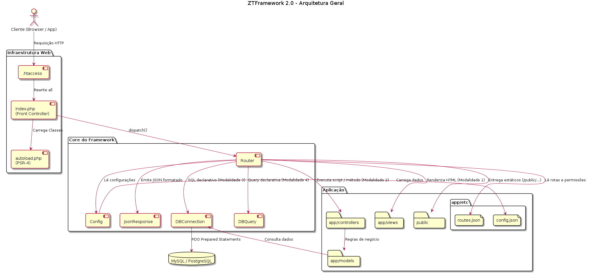
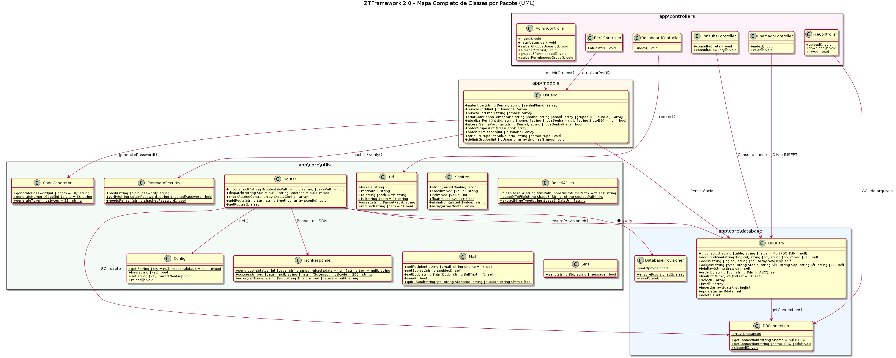
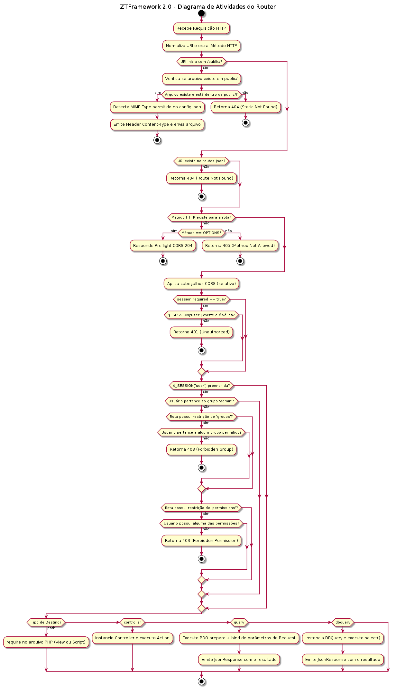
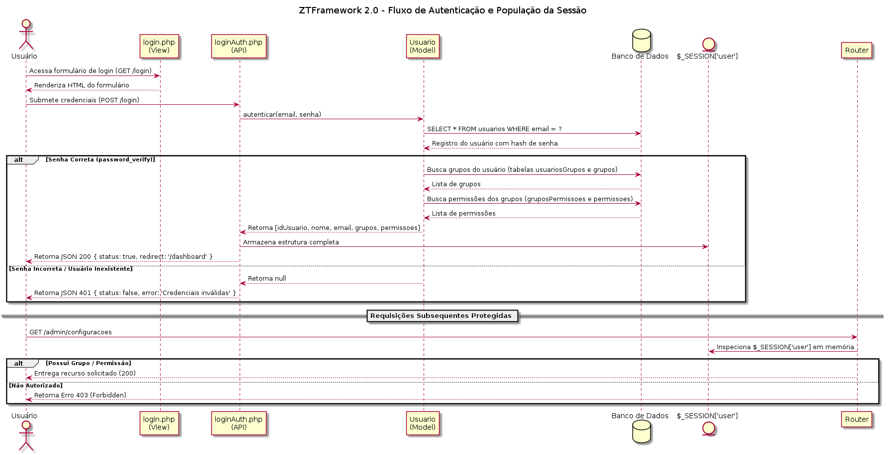
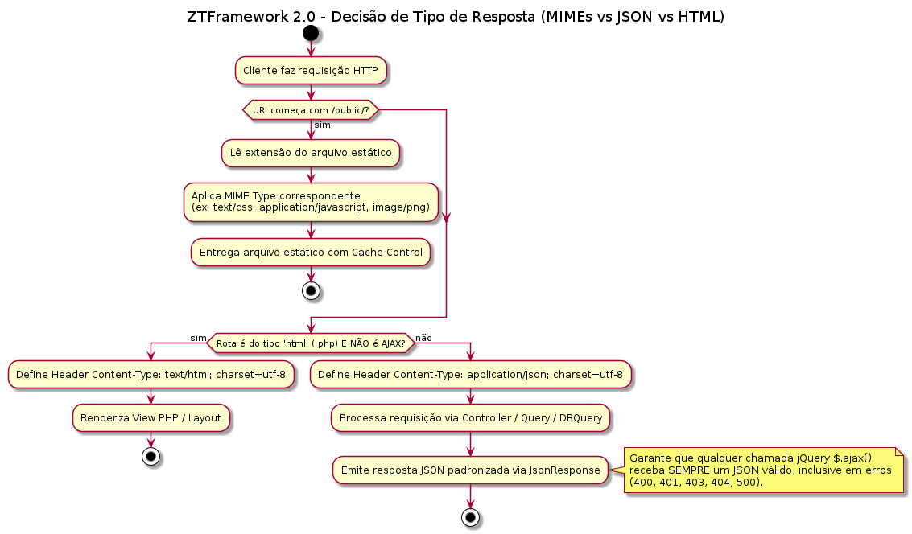
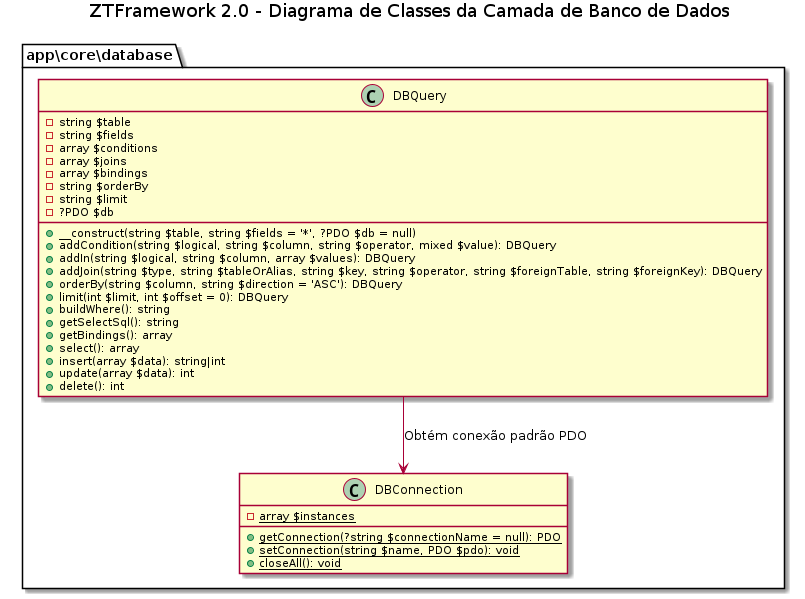
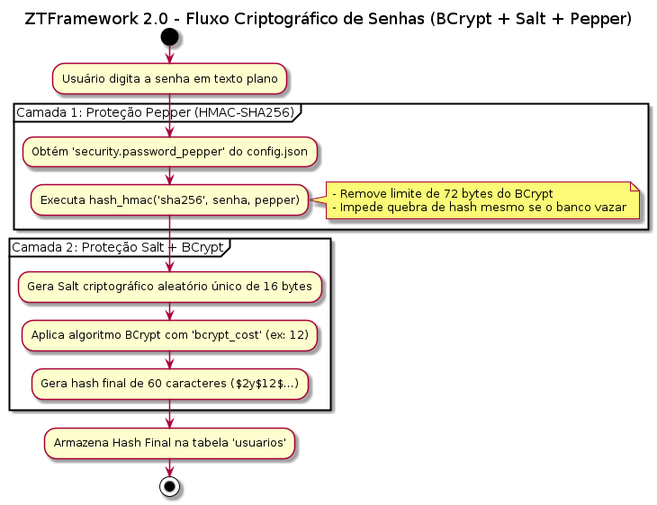
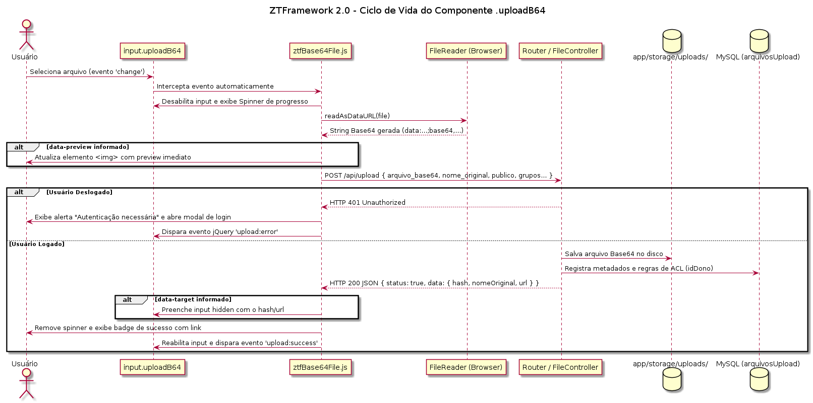
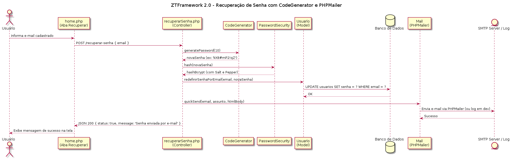

# Zait Tiny Framework 2.0 — Manual Oficial & Apostila do Desenvolvedor

```
================================================================================
                    Zait Tiny Framework 2.0 (PHP 8.2+)
================================================================================
Autores Oficiais:
  - Professor Drº Cleber S. Oliveira
  - Professora Drª Marcia Aparecida Silva Bissaco

Padrão de Qualidade:
  - Strict Types (declare(strict_types=1);)
  - UTF-8 (utf8mb4) de ponta a ponta
  - Multi-SGBD: MySQL, PostgreSQL, Oracle e IBM DB2
================================================================================
```

---

## Sumário
1. [Visão Geral, Filosofia & Diagrama de Arquitetura Geral](#1-visão-geral-filosofia--diagrama-de-arquitetura-geral)
2. [Estrutura de Diretórios & Mapa Completo de Classes (UML)](#2-estrutura-de-diretórios--mapa-completo-de-classes-uml)
3. [Autoloader Recursivo Inteligente](#3-autoloader-recursivo-inteligente)
4. [Roteamento Declarativo Completo (Router 2.0) & Diagramas de Fluxo](#4-roteamento-declarativo-completo-router-20--diagramas-de-fluxo)
5. [Suporte Multi-Banco de Dados (MySQL, PostgreSQL, Oracle, DB2)](#5-suporte-multi-banco-de-dados)
6. [Auto-Provisionamento no Início do Router](#6-auto-provisionamento-no-início-do-router)
7. [Query Builder Fluent (`DBQuery`) & Diagrama da Camada de Dados](#7-query-builder-fluent-dbquery--diagrama-da-camada-de-dados)
8. [Segurança Criptográfica & Autenticação (BCrypt + Salt + Pepper)](#8-segurança-criptográfica--autenticação-bcrypt--salt--pepper)
9. [Uploads em Base64 & Lista de Controle de Acesso (ACL)](#9-uploads-em-base64--lista-de-controle-de-acesso-acl)
10. [Sugestões de Integração: E-mails (Mailtrap e outros) & Diagrama de Recuperação](#10-sugestões-de-integração-e-mails-mailtrap-e-outros--diagrama-de-recuperação)
11. [Sugestões de Integração: SMS & OTP (Twilio e outros)](#11-sugestões-de-integração-sms--otp-twilio-e-outros)
12. [Material Didático: Aula Completa de Cada Classe do Framework (20 Aulas)](#12-material-didático-aula-completa-de-cada-classe-do-framework-20-aulas)
13. [Apostila Prática: Construindo um Módulo Completo Passo a Passo](#13-apostila-prática-construindo-um-módulo-completo-passo-a-passo)
14. [Suíte de Testes Automatizados (9 Suítes / 100% Cobertura)](#14-suíte-de-testes-automatizados)

---

## 1. Visão Geral, Filosofia & Diagrama de Arquitetura Geral

O **Zait Tiny Framework 2.0** foi concebido pelos professores **Drº Cleber S. Oliveira** e **Drª Marcia Aparecida Silva Bissaco** com foco em **altíssimo desempenho, clareza didática, segurança nativa e zero dependências pesadas de terceiros**.

### Pilares Fundamentais:
- **Tipagem Forte Estrita**: `declare(strict_types=1);` em todos os scripts do núcleo.
- **Auto-Provisionamento no Boot**: Se o banco de dados configurado não existir, o framework o cria e popula sua estrutura (DDL + DML) automaticamente no primeiro acesso.
- **Isolamento Criptográfico**: Senhas protegidas com BCrypt + Salt + Pepper HMAC-SHA256 (eliminando o limite de 72 bytes e protegendo contra vazamentos de dump de banco).
- **Arquitetura 100% Base64**: Uploads de fotos e documentos tratados em Base64 com ACL individual e por grupos.
- **AJAX Transparente**: Requisições assíncronas do jQuery recebem estritamente JSON padronizado com HTTP Status Codes adequados (200, 400, 401, 403, 404, 500).

### Diagrama 1: Arquitetura Geral do ZTFramework 2.0 (`Architecture.puml`)



#### Explicação Didática da Arquitetura:
1. **Infraestrutura Web (`.htaccess` &rarr; `index.php` &rarr; `autoload.php`)**: Todas as requisições HTTP convergem para o Front Controller (`index.php`), que inicializa o autoloader híbrido (Composer + PSR-4 nativo recursivo) e aciona `Router::dispatch()`.
2. **Núcleo do Framework (`app\core`)**: O `Router` consulta o `Config` (`app/etc/config.json`) e o catálogo de rotas (`app/etc/routes.json`), verifica o auto-provisionamento via `DatabaseProvisioner` e decide entre entregar ativos estáticos (`publicZone`) ou despachar a requisição por uma das **4 modalidades** (View direta, Controller OO, SQL declarativo ou `DBQuery` declarativa).
3. **Camada de Dados & Resposta**: Todas as consultas passam por Prepared Statements no `DBConnection`/`DBQuery`, e as APIs respondem por meio do envelope padronizado `JsonResponse`.

---

## 2. Estrutura de Diretórios & Mapa Completo de Classes (UML)

```text
ZTFramework/
├── app/
│   ├── controllers/         # Controladores da aplicação (AdminController, ChamadoController, ConsultaController, DashboardController, FileController, PerfilController, login.php, etc.)
│   ├── core/
│   │   ├── database/        # DBConnection, DBQuery, DatabaseProvisioner, script.sql
│   │   └── utils/           # Router, Config, Url, PasswordSecurity, CodeGenerator, Base64Files, Mail, Sms, Sanitize, JsonResponse
│   ├── documentation/       # Diagramas de arquitetura (.puml / .png) e manuais técnicos (.txt)
│   ├── etc/
│   │   ├── config.json      # Configurações globais (bancos, e-mail, sms, pepper, mimes da publicZone)
│   │   └── routes.json      # Catálogo centralizado de rotas, verbos e regras de ACL
│   ├── models/              # Modelos de domínio integrados ao DBQuery (Usuario.php)
│   ├── storage/             # Armazenamento privado (uploads base64, logs de e-mail/sms, sessões)
│   └── views/               # Telas do sistema (home.php, main*.php, admin.php, chamados.php e errors/)
├── public/
│   ├── assets/              # Arquivos públicos (css, js, images/diagrams/)
│   └── manual.html          # Manual interativo e didático do desenvolvedor em HTML
├── tests/                   # 9 suítes integradas de testes automatizados
├── autoload.php             # Autoloader recursivo com suporte a Composer e helpers de URL
└── index.php                # Front Controller (Ponto de Entrada Único)
```

### Diagrama 2: Mapa Completo de Classes por Pacote (`Classes_Map.puml`)



---

## 3. Autoloader Recursivo Inteligente

O arquivo `autoload.php` resolve automaticamente qualquer classe do sistema em três camadas:
1. **Integração Composer (`vendor/autoload.php`)**: Carrega bibliotecas instaladas via Composer (como `PHPMailer\PHPMailer`) e o classmap otimizado.
2. **Resolução Direta PSR-4**: Traduz `app\controllers\MeuController` instantaneamente para `app/controllers/MeuController.php`.
3. **Fallback Recursivo Case-Insensitive**: Percorre a árvore de `app/` no Linux localizando classes dinamicamente mesmo se houver divergência de capitalização.
4. **Helpers Globais de Roteamento**: Disponibiliza `url()`, `asset()` e `rootPath()` integrados à classe `app\core\utils\Url`.

---

## 4. Roteamento Declarativo Completo (Router 2.0) & Diagramas de Fluxo

Todas as rotas são declaradas no arquivo `app/etc/routes.json`.

### Diagrama 3: Fluxo de Decisão e Despacho do Router 2.0 (`Router.puml`)



### Diagrama 4: Autenticação e Guarda de Sessão / ACL em Memória (`Session_ACL.puml`)



### Diagrama 5: Decisão Inteligente de MIME Types vs HTML vs JSON para AJAX (`Ajax_MimeTypes.puml`)



### 4.1 Anatomia Completa de uma Rota
```json
{
  "/exemplo/completo/{id}": {
    "get": {
      "responseType": "json",
      "controller": "MeuController",
      "action": "detalhes",
      "session": {
        "required": true,
        "keys": ["idUsuario", "email"]
      },
      "users": [1, 2, 5],
      "groups": ["admin", "gerente"],
      "strictGroup": false,
      "permissions": ["usuarios.view", "relatorios.export"],
      "cors": {
        "enable": true,
        "origins": ["https://meusite.com"]
      }
    }
  }
}
```

### 4.2 Os 4 Alvos de Execução (Dispatch Handlers)
1. **Script / View Direta (`"path"`)**: `"path": "app/views/home.php"`
2. **Controller & Action (`"controller"` + `"action"`)**: Instancia `app\controllers\NomeController` e invoca o método.
3. **Consulta Declarativa SQL (`"query"`)**: Executa `SELECT` parametrizado via PDO direto do `routes.json` e retorna JSON.
4. **Consulta Declarativa DBQuery (`"dbquery"`)**: Constrói e executa uma consulta `DBQuery` a partir do JSON.

---

## 5. Suporte Multi-Banco de Dados

O componente `DBConnection` conecta a 4 grandes bancos corporativos através de PDO:
- **MySQL / MariaDB**: `driver: "mysql"` (Porta 3306)
- **PostgreSQL**: `driver: "pgsql"` (Porta 5432)
- **Oracle Database**: `driver: "oci"` (Porta 1521, Easy Connect `//host:port/service`)
- **IBM DB2**: `driver: "ibm"` (Porta 50000, ODBC/IBM CLI)

---

## 6. Auto-Provisionamento no Início do Router

No boot de cada requisição, o `DatabaseProvisioner`:
1. Valida se a base de dados configurada existe; caso não exista, executa `CREATE DATABASE IF NOT EXISTS ...` em `utf8mb4`.
2. Confere as 6 tabelas essenciais (`usuarios`, `grupos`, `permissoes`, `usuariosGrupos`, `gruposPermissoes`, `arquivosUpload`); se ausentes, executa `app/core/database/script.sql` (DDL + DML com usuários e grupos semente).
3. Se o banco estiver inacessível por credenciais incorretas, exibe a tela diagnóstica `app/views/errors/db_error.php` sem expor senhas.

---

## 7. Query Builder Fluent (`DBQuery`) & Diagrama da Camada de Dados

### Diagrama 6: Arquitetura de Classes da Camada de Banco (`DBQuery.puml`)



```php
use app\core\database\DBQuery;

// SELECT com filtro e primeiro registro:
$user = (new DBQuery('usuarios'))
    ->addCondition('AND', 'email', '=', $email)
    ->first();

// JOINs múltiplos:
$dados = (new DBQuery('chamados c', 'c.*, u.nome AS solicitante'))
    ->joinRaw('INNER JOIN usuarios u ON u.idUsuario = c.idUsuario')
    ->orderBy('c.idChamado', 'DESC')
    ->select();
```

---

## 8. Segurança Criptográfica & Autenticação (BCrypt + Salt + Pepper)

$$\text{Hash} = \text{BCrypt}(\text{HMAC-SHA256}(\text{senha}, \text{Pepper}), \text{Salt})$$

### Diagrama 7: Pipeline Criptográfico em Duas Camadas (`PasswordSecurity.puml`)



- **Proteção contra Dump**: Se a base for vazada, a ausência do Pepper (que reside apenas em `app/etc/config.json`) impede ataques de força bruta offline.
- **Fim do Limite de 72 Bytes**: Senhas longas são pré-processadas via HMAC-SHA256 gerando 64 caracteres hexadecimais antes do BCrypt.

---

## 9. Uploads em Base64 & Lista de Controle de Acesso (ACL)

### Diagrama 8: Ciclo de Vida do Componente `.uploadB64` e `FileController` (`UploadB64_Component.puml`)



Campos com a classe `.uploadB64` convertem automaticamente arquivos em Base64 no navegador via `FileReader` (`public/assets/js/ztfBase64File.js`) e enviam para `/api/upload` (`FileController::upload()`), gravando em `app/storage/uploads/` com ACL granular (`idDono`, `publico`, `gruposPermitidos`, `usuariosPermitidos`).

---

## 10. Sugestões de Integração: E-mails (Mailtrap e outros) & Diagrama de Recuperação

### Diagrama 9: Fluxo de Recuperação de Senha com `CodeGenerator` e `Mail` (`Mail_Recovery.puml`)



- **Mailtrap**: Configure `sandbox.smtp.mailtrap.io` (porta 2525) em `config.json` para capturar e-mails em homologação.
- **Simulação Local**: Com `simulate_in_dev: true`, os disparos são gravados em `app/storage/logs/mail.log`.

---

## 11. Sugestões de Integração: SMS & OTP (Twilio e outros)

A classe `Sms` permite envio de mensagens e códigos de 2 fatores (2FA) via **Twilio REST API** ou simulação local em `app/storage/logs/sms.log`.

---

## 12. Material Didático: Aula Completa de Cada Classe do Framework (20 Aulas)

Esta seção apresenta uma aula detalhada para **cada uma das classes que compõem o Zait Tiny Framework 2.0**, dividida nos 4 pacotes da arquitetura.

---

### Módulo I — Pacote de Banco de Dados (`app\core\database`)

#### Aula 1: Classe `DBConnection` (`app/core/database/DBConnection.php`)
- **Objetivo Didático**: Compreender o padrão *Multiton/Singleton* aplicado a conexões PDO multi-banco.
- **Responsabilidade**: Gerenciar o pool de conexões ativas em memória (`self::$instances`), evitando reabertura repetitiva de sockets TCP com o banco de dados durante a mesma requisição HTTP.
- **Principais Métodos**:
  - `DBConnection::getConnection(?string $connectionName = null): PDO`: Lê as credenciais do `Config`, monta o DSN específico (`mysql`, `pgsql`, `oci`, `ibm`), ativa `PDO::ATTR_ERRMODE => PDO::ERRMODE_EXCEPTION` e `PDO::ATTR_EMULATE_PREPARES => false`, e retorna a instância PDO.
  - `DBConnection::setConnection(string $name, PDO $pdo): void`: Permite injetar conexões mockadas ou customizadas em testes automatizados.
  - `DBConnection::closeAll(): void`: Encerra todas as conexões do pool.
- **Exemplo Prático**:
  ```php
  use app\core\database\DBConnection;

  // Obtém a conexão padrão (definida em database.default no config.json)
  $pdo = DBConnection::getConnection();
  $stmt = $pdo->query("SELECT COUNT(*) AS total FROM usuarios");
  $res = $stmt->fetch();
  ```

---

#### Aula 2: Classe `DatabaseProvisioner` (`app/core/database/DatabaseProvisioner.php`)
- **Objetivo Didático**: Entender arquiteturas *Self-Healing* (auto-provisionáveis) no boot da aplicação.
- **Responsabilidade**: Garantir que o schema do banco e todas as tabelas essenciais existam antes que qualquer consulta de negócio seja executada pelo `Router`.
- **Principais Métodos**:
  - `DatabaseProvisioner::ensureProvisioned(): array`: Conecta ao servidor MySQL sem exigir que o banco já exista, executa `CREATE DATABASE IF NOT EXISTS`, verifica as 6 tabelas fundamentais (`usuarios`, `grupos`, `permissoes`, `usuariosGrupos`, `gruposPermissoes`, `arquivosUpload`) e, caso falte alguma, executa `app/core/database/script.sql`.
  - `DatabaseProvisioner::resetState(): void`: Reinicia a flag estática `$provisioned` para baterias de testes de resiliência.
- **Exemplo Prático**:
  ```php
  use app\core\database\DatabaseProvisioner;

  $status = DatabaseProvisioner::ensureProvisioned();
  if (!$status['status']) {
      // Exibe diagnóstico amigável sem expor a senha do banco
      echo $status['message'];
  }
  ```

---

#### Aula 3: Classe `DBQuery` (`app/core/database/DBQuery.php`)
- **Objetivo Didático**: Dominar a construção fluente de queries SQL parametrizadas (Fluent Interface) imunes a SQL Injection.
- **Responsabilidade**: Abstrair operações CRUD (`SELECT`, `INSERT`, `UPDATE`, `DELETE`), cláusulas `WHERE`, `WHERE IN`, `JOIN`, `ORDER BY` e `LIMIT/OFFSET` usando exclusivamente *Prepared Statements* e bloqueando `UPDATE` ou `DELETE` sem `WHERE`.
- **Principais Métodos**:
  - `__construct(string $table, string $fields = '*', ?PDO $db = null)`
  - `addCondition(string $logical, string $column, string $operator, mixed $value): self`
  - `addIn(string $logical, string $column, array $values): self`
  - `addJoin(string $type, string $tableOrAlias, string $key, string $operator, string $foreignTable, string $foreignKey): self`
  - `joinRaw(string $rawJoin): self`
  - `orderBy(string $column, string $direction = 'ASC'): self` e `limit(int $limit, int $offset = 0): self`
  - `select(): array`, `first(): ?array`, `insert(array $data): string|int`, `update(array $data): int`, `delete(): int`
- **Exemplo Prático**:
  ```php
  use app\core\database\DBQuery;

  $ativos = (new DBQuery('usuarios', 'idUsuario, nome, email'))
      ->addCondition('AND', 'status', '=', 1)
      ->addIn('AND', 'idUsuario', [1, 2, 3])
      ->orderBy('nome', 'ASC')
      ->limit(10)
      ->select();
  ```

---

### Módulo II — Pacote de Utilitários, Roteamento e Segurança (`app\core\utils`)

#### Aula 4: Classe `Config` (`app/core/utils/Config.php`)
- **Objetivo Didático**: Centralizar parâmetros de infraestrutura fora do código-fonte usando notação de ponto (*dot notation*).
- **Responsabilidade**: Carregar `app/etc/config.json` uma única vez em memória e permitir leitura/escrita rápida de chaves aninhadas.
- **Principais Métodos**:
  - `Config::get(?string $key = null, mixed $default = null): mixed`
  - `Config::has(string $key): bool`
  - `Config::set(string $key, mixed $value): void`
  - `Config::reload(): void`
- **Exemplo Prático**:
  ```php
  use app\core\utils\Config;

  $appName = Config::get('app.name', 'ZTFramework');
  $cost    = (int)Config::get('security.bcrypt_cost', 12);
  ```

---

#### Aula 5: Classe `Url` (`app/core/utils/Url.php`)
- **Objetivo Didático**: Resolver automaticamente o `rootPath` e gerar URLs portáteis tanto em subpastas (`/ZTFramework/`) quanto na raiz de um domínio (`/`).
- **Responsabilidade**: Detectar o diretório base de execução a partir de `$_SERVER['SCRIPT_NAME']` ou `app.base_path`, alimentar a tag `<base href="...">` das views e realizar redirecionamentos seguros.
- **Principais Métodos**:
  - `Url::base(): string`: Retorna o caminho base com barra final garantida (ex: `'/ZTFramework/'` ou `'/'`).
  - `Url::rootPath(): string`: Retorna o prefixo sem barra final (ex: `'/ZTFramework'` ou `''`).
  - `Url::to(string $path = ''): string`: Monta URL relativa à raiz do projeto (ex: `Url::to('login')` &rarr; `'/ZTFramework/login'`).
  - `Url::asset(string $assetPath): string`: Aponta para ativos dentro de `public/` (ex: `Url::asset('assets/css/style.css')`).
  - `Url::full(string $path = ''): string`: Retorna URL absoluta com protocolo `http(s)://` e host.
  - `Url::redirect(string $path = ''): void`: Envia header `Location` respeitando o `rootPath`.
- **Exemplo Prático**:
  ```php
  use app\core\utils\Url;

  $baseHref = Url::base(); // Usado em <base href="<?= $baseHref ?>">
  $urlLogin = Url::to('login');
  ```

---

#### Aula 6: Classe `Router` (`app/core/utils/Router.php`)
- **Objetivo Didático**: Compreender o funcionamento de um *Front Controller Router* declarativo com guarda de segurança (ACL) em memória.
- **Responsabilidade**: Ler `app/etc/routes.json`, tratar ativos da `publicZone` bloqueando *Path Traversal*, gerenciar CORS, validar sessão/grupos/permissões em `$_SESSION['user']` e despachar para Views, Controllers, SQL direto ou `DBQuery`.
- **Principais Métodos**:
  - `__construct(?string $routesFilePath = null, ?string $basePath = null)`
  - `dispatch(?string $uri = null, ?string $method = null): mixed`
  - `checkAccessControl(array $routeConfig): array`
  - `addRoute(string $uri, string $method, array $config): void`
- **Exemplo Prático**:
  ```php
  use app\core\utils\Router;

  $router = new Router();
  $router->dispatch(); // Processa a requisição HTTP atual
  ```

---

#### Aula 7: Classe `Sanitize` (`app/core/utils/Sanitize.php`)
- **Objetivo Didático**: Prevenir ataques de Cross-Site Scripting (XSS) e injeção de tags maliciosas na entrada de dados.
- **Responsabilidade**: Limpar strings, e-mails, inteiros, decimais, identificadores alfanuméricos e arrays multidimensionais recursivamente.
- **Principais Métodos**:
  - `Sanitize::string(mixed $value): string`: Remove blocos `<script>`, `<style>`, tags HTML e caracteres de controle invisíveis, aplicando `htmlspecialchars(..., ENT_QUOTES | ENT_SUBSTITUTE, 'UTF-8')`.
  - `Sanitize::email(mixed $value): string`
  - `Sanitize::int(mixed $value): int` e `Sanitize::float(mixed $value): float`
  - `Sanitize::alphaNum(mixed $value): string`
  - `Sanitize::array(array $data): array`
- **Exemplo Prático**:
  ```php
  use app\core\utils\Sanitize;

  $nomeLimpo = Sanitize::string($_POST['nome'] ?? '');
  $email     = Sanitize::email($_POST['email'] ?? '');
  ```

---

#### Aula 8: Classe `JsonResponse` (`app/core/utils/JsonResponse.php`)
- **Objetivo Didático**: Padronizar contratos de resposta JSON em APIs REST e chamadas AJAX.
- **Responsabilidade**: Emitir o HTTP Status Code correto, cabeçalho `Content-Type: application/json; charset=utf-8` e um envelope JSON uniforme `{ status, code, error, message, data }` com `JSON_UNESCAPED_UNICODE`.
- **Principais Métodos**:
  - `JsonResponse::success(mixed $data = null, string $message = 'Operação realizada com sucesso.', int $httpCode = 200): string`
  - `JsonResponse::error(int $httpCode, string $errorCode, string $message, mixed $details = null): string`
  - `JsonResponse::send(bool $status, int $httpCode, string $message, mixed $data = null, ?string $errorCode = null): string`
- **Exemplo Prático**:
  ```php
  use app\core\utils\JsonResponse;

  JsonResponse::success(['id' => 42], 'Registro salvo com sucesso!');
  ```

---

#### Aula 9: Classe `PasswordSecurity` (`app/core/utils/PasswordSecurity.php`)
- **Objetivo Didático**: Implementar defesa em profundidade para armazenamento de senhas com Pepper HMAC-SHA256 + Salt + BCrypt.
- **Responsabilidade**: Pré-processar a senha em texto plano com `hash_hmac('sha256', $plainPassword, $pepper)` antes do `password_hash(..., PASSWORD_BCRYPT)`, superando o limite de 72 bytes do BCrypt e inutilizando ataques a dumps de banco sem o `config.json`.
- **Principais Métodos**:
  - `PasswordSecurity::hash(string $plainPassword): string`
  - `PasswordSecurity::verify(string $plainPassword, string $hashedPassword): bool`
  - `PasswordSecurity::needsRehash(string $hashedPassword): bool`
- **Exemplo Prático**:
  ```php
  use app\core\utils\PasswordSecurity;

  $hash = PasswordSecurity::hash('MinhaSenhaForte#2026');
  $valido = PasswordSecurity::verify('MinhaSenhaForte#2026', $hash); // true
  ```

---

#### Aula 10: Classe `CodeGenerator` (`app/core/utils/CodeGenerator.php`)
- **Objetivo Didático**: Utilizar geradores pseudoaleatórios criptograficamente seguros (CSPRNG) do PHP (`random_int` e `random_bytes`).
- **Responsabilidade**: Gerar senhas temporárias legíveis (sem caracteres ambíguos como `0/O`, `1/l/I`), códigos numéricos OTP de 6 dígitos e tokens hexadecimais de alta entropia.
- **Principais Métodos**:
  - `CodeGenerator::generatePassword(int $length = 10): string`
  - `CodeGenerator::generateNumericCode(int $digits = 6): string`
  - `CodeGenerator::generateToken(int $bytes = 32): string`
- **Exemplo Prático**:
  ```php
  use app\core\utils\CodeGenerator;

  $senhaTemp = CodeGenerator::generatePassword(10);
  $otp       = CodeGenerator::generateNumericCode(6);
  ```

---

#### Aula 11: Classe `Base64Files` (`app/core/utils/Base64Files.php`)
- **Objetivo Didático**: Manipular conversões entre arquivos binários no sistema de arquivos e payloads Base64 RFC 2045 / Data URIs.
- **Responsabilidade**: Converter arquivos físicos para Base64 (com ou sem prefixo MIME `data:...;base64,`), restaurar binários no disco a partir de strings Base64 e extrair MIME types de Data URIs.
- **Principais Métodos**:
  - `Base64Files::fileToBase64(string $filePath, bool $withMimePrefix = false): string`
  - `Base64Files::base64ToFile(string $base64String, string $outputPath): int`
  - `Base64Files::extractMimeType(string $base64DataUri): ?string`
- **Exemplo Prático**:
  ```php
  use app\core\utils\Base64Files;

  $mime = Base64Files::extractMimeType($dataUri); // ex: 'image/png'
  Base64Files::base64ToFile($dataUri, '/tmp/imagem.png');
  ```

---

#### Aula 12: Classe `Mail` (`app/core/utils/Mail.php`)
- **Objetivo Didático**: Integrar envio de e-mails transacionais HTML via SMTP autenticado (PHPMailer) com fallback de simulação local para desenvolvimento.
- **Responsabilidade**: Configurar servidor SMTP a partir do `config.json` (`mail`), suportar destinatários, assunto e corpo HTML em `UTF-8`, ou gravar o disparo em `app/storage/logs/mail.log` quando `simulate_in_dev` está ativo.
- **Principais Métodos**:
  - `setRecipient(string $email, string $name = ''): self`
  - `setSubject(string $subject): self` e `setBody(string $htmlBody, string $altText = ''): self`
  - `send(): bool`
  - `Mail::quickSend(string $toEmail, string $toName, string $subject, string $htmlBody): bool`
- **Exemplo Prático**:
  ```php
  use app\core\utils\Mail;

  Mail::quickSend('aluno@dominio.com', 'Aluno', 'Bem-vindo!', '<h1>Acesso Liberado</h1>');
  ```

---

#### Aula 13: Classe `Sms` (`app/core/utils/Sms.php`)
- **Objetivo Didático**: Disparar notificações SMS e códigos 2FA via REST API (Twilio) ou log local simulado.
- **Responsabilidade**: Enviar requisição HTTP POST autenticada para a API do Twilio (`Messages.json`) usando cURL ou registrar em `app/storage/logs/sms.log` no modo de desenvolvimento.
- **Principais Métodos**:
  - `Sms::send(string $to, string $message): bool`
- **Exemplo Prático**:
  ```php
  use app\core\utils\Sms;

  Sms::send('+5511999990000', 'Seu codigo OTP: 482910');
  ```

---

### Módulo III — Pacote de Modelos de Domínio (`app\models`)

#### Aula 14: Classe `Usuario` (`app/models/Usuario.php`)
- **Objetivo Didático**: Estruturar um Model de domínio rico que encapsula autenticação, gestão de credenciais e resolução da árvore RBAC (Grupos e Permissões).
- **Responsabilidade**: Autenticar usuários validando `PasswordSecurity::verify()`, carregar grupos (`usuariosGrupos` + `grupos`) e permissões (`gruposPermissoes` + `permissoes`), cadastrar contas com senha temporária e atualizar perfil mantendo o e-mail estritamente imutável.
- **Principais Métodos**:
  - `autenticar(string $email, string $senhaPlana): ?array`
  - `criarComSenhaTemporaria(string $nome, string $email, array $grupos = ['usuario']): array`
  - `atualizarPerfil(int $idUsuario, string $nome, ?string $novaSenhaPlana = null, ?string $fotoBase64 = null): bool`
  - `alterarSenhaPorEmail(string $email, string $novaSenhaPlana): bool`
  - `obterGrupos(int $idUsuario): array` e `obterPermissoes(int $idUsuario): array`
  - `atribuirGrupo(int $idUsuario, string $nomeGrupo): void` e `definirGrupos(int $idUsuario, array $nomesGrupos): void`
- **Exemplo Prático**:
  ```php
  use app\models\Usuario;

  $model = new Usuario();
  $dadosSessao = $model->autenticar('admin@ztframework.local', 'admin123');
  ```

---

### Módulo IV — Pacote de Controladores (`app\controllers`)

#### Aula 15: Classe `DashboardController` (`app/controllers/DashboardController.php`)
- **Objetivo Didático**: Orquestrar o roteamento inteligente de painéis por perfil de acesso (`admin`, `gerente`, `financeiro`, `suporte`, `usuario`).
- **Responsabilidade**: Receber o acesso em `/dashboard`, verificar se um administrador solicitou simulação de perfil via `?perfil=...` ou redirecionar o usuário logado para sua rota exclusiva `/dashboard/{perfil}` via `Url::redirect()`.

---

#### Aula 16: Classe `PerfilController` (`app/controllers/PerfilController.php`)
- **Objetivo Didático**: Processar atualizações cadastrais do próprio usuário com upload de avatar em Base64 e proteção contra escalada horizontal/adulteração de e-mail.
- **Responsabilidade**: Validar sessão em `/api/perfil/atualizar`, sanitizar nome, validar nova senha opcional e foto Base64, persistir via `Usuario::atualizarPerfil()` e sincronizar `$_SESSION['user']` em memória.

---

#### Aula 17: Classe `AdminController` (`app/controllers/AdminController.php`)
- **Objetivo Didático**: Implementar um painel de governança RBAC completo (usuários, grupos, status e matriz de permissões).
- **Responsabilidade**: Atender `/admin` e as APIs `/api/admin/*` restritas ao grupo `admin`:
  - `index()`: Renderiza a view `app/views/admin.php`.
  - `listarUsuarios()`: Retorna usuários com seus grupos concatenados.
  - `salvarGruposUsuario()`: Atualiza os níveis de acesso do usuário via `Usuario::definirGrupos()`.
  - `alternarStatus()`: Ativa/bloqueia contas impedindo que o administrador bloqueie a si próprio.
  - `gruposEPermissoes()` e `salvarPermissoesGrupo()`: Gerenciam a matriz de permissões de cada grupo.

---

#### Aula 18: Classe `FileController` (`app/controllers/FileController.php`)
- **Objetivo Didático**: Implementar armazenamento seguro de arquivos em Base64 com validação de ACL em 5 camadas na entrega (`download`).
- **Responsabilidade**:
  - `upload()`: Decodifica e valida o Base64, gera hash único de 32 caracteres hexadecimais, grava em `app/storage/uploads/{hash}.{ext}.base64` e registra metadados na tabela `arquivosUpload`.
  - `download()`: Verifica se o arquivo é público, se o requisitante é o dono (`idDono`), se é `admin`, se pertence a `gruposPermitidos` ou `usuariosPermitidos`, e transmite o binário com headers `X-Content-Type-Options: nosniff`.
  - `listar()`: Lista os arquivos visíveis ao usuário autenticado.

---

#### Aula 19: Classe `ChamadoController` (`app/controllers/ChamadoController.php`)
- **Objetivo Didático**: Demonstrar um CRUD relacional moderno com `DBQuery::joinRaw()` e resposta assíncrona para jQuery AJAX.
- **Responsabilidade**: Listar chamados em `/chamados` (`index()`) unindo a tabela `chamados` à tabela `usuarios`, e criar novos tickets via POST em `/api/chamados/novo` (`criar()`).

---

#### Aula 20: Classe `ConsultaController` e Controladores de Autenticação (`app/controllers/ConsultaController.php`, `login.php`, `loginAuth.php`, `registerAuth.php`, `recuperarSenha.php`, `logout.php`)
- **Objetivo Didático**: Comparar consultas PDO diretas vs `DBQuery` e compreender o ciclo completo de entrada, cadastro, recuperação de senha e encerramento de sessão.
- **Responsabilidade**:
  - `ConsultaController::consultaDireta()`: Demonstra consulta SQL com `DBConnection::getConnection()->query(...)`.
  - `ConsultaController::consultaDbQuery()`: Demonstra consulta com `DBQuery`, `joinRaw()` e agrupamento.
  - `login.php` / `loginAuth.php`: Exibe a tela de login e autentica populando `$_SESSION['user']`.
  - `registerAuth.php`: Cria usuário com senha temporária gerada por `CodeGenerator` e enviada via `Mail::quickSend()`.
  - `recuperarSenha.php`: Gera nova senha temporária, atualiza o hash BCrypt+Pepper e envia por e-mail.
  - `logout.php`: Limpa variáveis de sessão, invalida o cookie de sessão, executa `session_destroy()` e redireciona via `Url::redirect('login')`.

---

## 13. Apostila Prática: Construindo um Módulo Completo Passo a Passo

### Passo 1: Criar a Tabela no Banco (DDL)
```sql
CREATE TABLE IF NOT EXISTS `chamados` (
    `idChamado` INT AUTO_INCREMENT PRIMARY KEY,
    `idUsuario` INT NOT NULL,
    `titulo` VARCHAR(200) NOT NULL,
    `descricao` TEXT DEFAULT NULL,
    `status` ENUM('aberto', 'em_andamento', 'fechado') NOT NULL DEFAULT 'aberto',
    `dataAbertura` DATETIME NOT NULL DEFAULT CURRENT_TIMESTAMP,
    CONSTRAINT `fk_chamados_user` FOREIGN KEY (`idUsuario`) REFERENCES `usuarios` (`idUsuario`) ON DELETE CASCADE
) ENGINE=InnoDB DEFAULT CHARSET=utf8mb4 COLLATE=utf8mb4_unicode_ci;
```

### Passo 2: Declarar as Rotas em `app/etc/routes.json`
```json
{
  "/chamados": {
    "get": {
      "responseType": "html",
      "controller": "ChamadoController",
      "action": "index",
      "session": { "required": true, "keys": ["idUsuario"] }
    }
  },
  "/api/chamados/novo": {
    "post": {
      "responseType": "json",
      "controller": "ChamadoController",
      "action": "criar",
      "session": { "required": true, "keys": ["idUsuario"] }
    }
  }
}
```

### Passo 3: Criar o Controller (`app/controllers/ChamadoController.php`)
```php
<?php
declare(strict_types=1);

namespace app\controllers;

use app\core\database\DBQuery;
use app\core\utils\JsonResponse;
use app\core\utils\Sanitize;

class ChamadoController {
    public function index(): void {
        $chamados = (new DBQuery('chamados c', 'c.*, u.nome AS solicitante'))
            ->joinRaw('INNER JOIN usuarios u ON u.idUsuario = c.idUsuario')
            ->orderBy('c.idChamado', 'DESC')
            ->select();

        require dirname(__DIR__) . '/views/chamados.php';
    }

    public function criar(): void {
        $titulo    = Sanitize::string($_POST['titulo'] ?? '');
        $descricao = Sanitize::string($_POST['descricao'] ?? '');
        $idUsuario = (int)($_SESSION['user']['idUsuario'] ?? 0);

        if (empty($titulo)) {
            JsonResponse::error(400, 'ERR_EMPTY_TITLE', 'O título é obrigatório.');
            return;
        }

        $id = (new DBQuery('chamados'))->insert([
            'idUsuario' => $idUsuario,
            'titulo'    => $titulo,
            'descricao' => $descricao,
            'status'    => 'aberto'
        ]);

        JsonResponse::success([
            'idChamado'    => $id,
            'titulo'       => $titulo,
            'solicitante'  => $_SESSION['user']['nome'] ?? 'Eu',
            'dataAbertura' => date('d/m/Y H:i')
        ], 'Chamado registrado com sucesso!');
    }
}
```

---

## 14. Suíte de Testes Automatizados

Execute todas as 9 suítes com:
```bash
php tests/run_all.php
```
Aprovação de 100% cobrindo Config, Router, DBQuery, BCrypt com Pepper, Mail, AJAX Mimes, Fluxo Completo de Negócio, Segurança OWASP Top 10 e RootPath/Endpoints.

---

> **Zait Tiny Framework 2.0** — Desenvolvido pelos Professores **Drº Cleber S. Oliveira** e **Drª Marcia Aparecida Silva Bissaco**.
